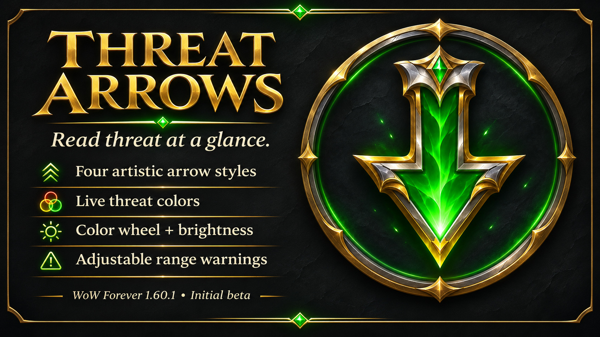
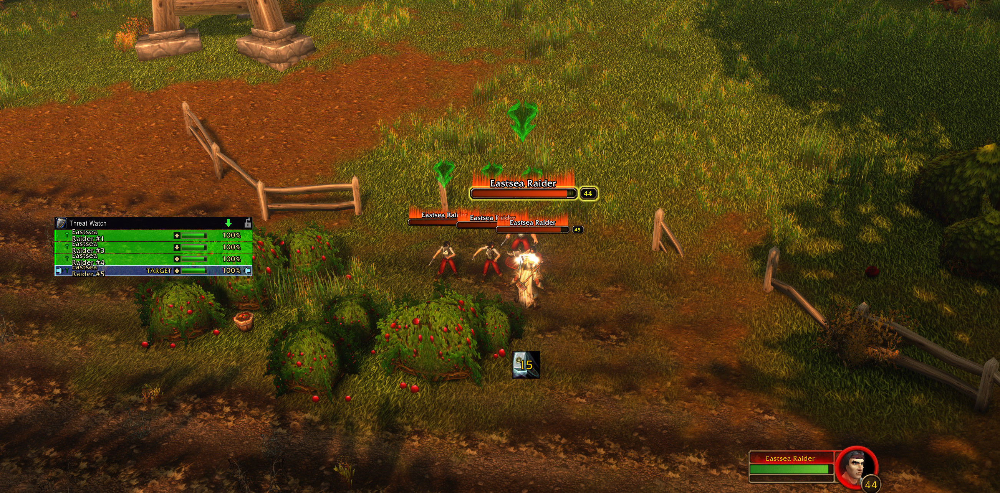
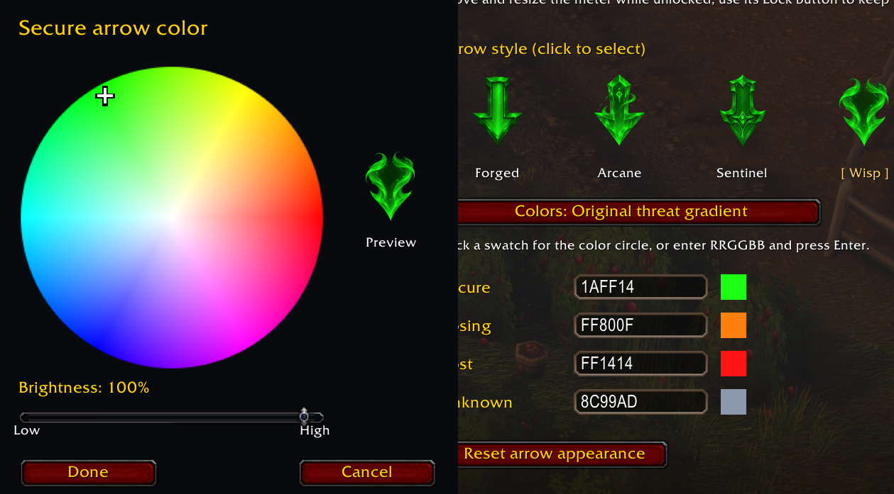
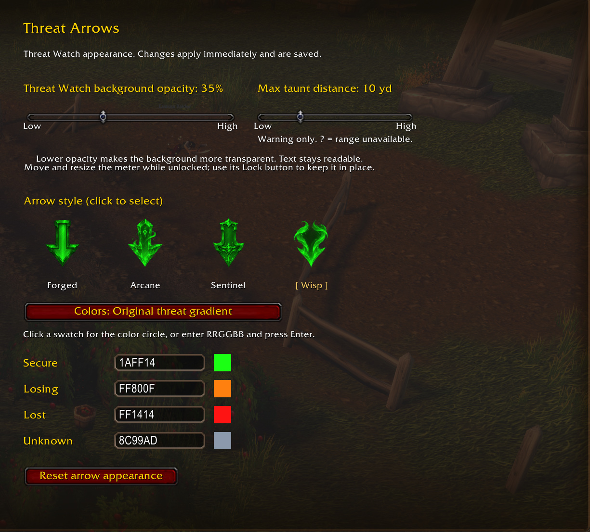
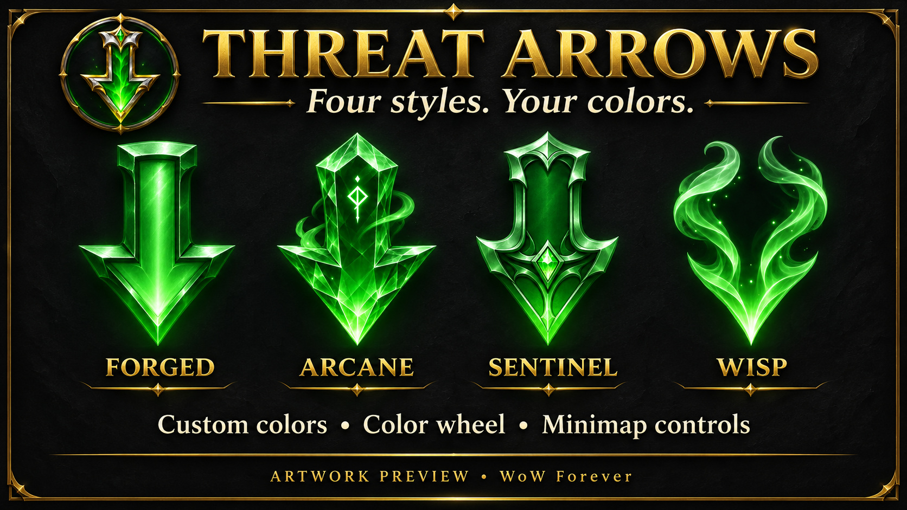

# Threat Arrows



A display-only World of Warcraft Forever addon (interface 16001). Current version: **2.3.0**.

## Features

- Four smooth arrow styles: Forged, Arcane, Sentinel and Wisp.
- Custom secure, losing, lost and unknown threat colors, with a circular color picker, brightness control and live preview.
- Clean arrows without percentage text; the Threat Watch panel retains threat percentages.
- A draggable minimap shield icon: left-click opens settings, right-click toggles Threat Watch.
- An adjustable range warning from 1–40 yards, defaulting to 10 yards. Unavailable or restricted range information shows unknown.
- Saved appearance, panel layout, lock state and minimap position.

The addon does not change targets, cast spells or send game input. Range warnings do not change any spell's actual range.

## License

All Rights Reserved. Free to download and use for personal gameplay. See [LICENSE](LICENSE) for terms.

## Install

1. Download or clone this repository and close WoW.
2. Run `app/Install-ThreatArrows.cmd` and select the Forever game folder containing `Wow.exe` or `WowB.exe`.
3. Launch WoW, enable Threat Arrows in AddOns, and enable enemy nameplates (usually V).
4. Open settings from the minimap shield icon or type `/ta options`.

For a manual installation, copy the entire `app/addons/ThreatArrows` folder into the game's `Interface/AddOns` folder. The final layout must include `Interface/AddOns/ThreatArrows/ThreatArrows.toc`, `ThreatArrows.lua`, and the `Media` folder. Existing saved settings are preserved.

## Development and tests

Canonical addon source and artwork are under `app/addons/ThreatArrows`. The installer and detailed notes are in `app/`. Mock tests do not launch WoW or send game input.

Run from the repository root with Lua 5.1:

```sh
lua5.1 Tests/ThreatArrows.Mock.Tests.lua
```

Or, with Python and the `lupa` package installed:

```sh
python -c "from lupa.lua51 import LuaRuntime; LuaRuntime().execute(open('Tests/ThreatArrows.Mock.Tests.lua').read())"
```

See [the detailed addon guide](app/THREAT-ARROWS.md) for commands and range-data limitations. In-game rendering and client API behavior still need a manual check in Forever.

This repository contains the standalone Threat Arrows addon, installer and tests.

## Public distribution

The release package targets **Forever 1.60.1** only. Build the addon-only ZIP with `python Tools/Build-Release.py`; it is written to `dist/`. The ZIP has a single `ThreatArrows` folder at its root and contains no external installer or runtime settings. CurseForge submission copy and version tags are recorded in [publishing/CurseForge.md](publishing/CurseForge.md).

CurseForge: [Threat Arrows](https://www.curseforge.com/wow/addons/threat-arrows). The initial Forever beta was submitted on November 27, 2026; first publication requires CurseForge moderation.

## Screenshots

### In-game combat



### Color circle and live preview



### Appearance and range settings



### Arrow artwork preview


